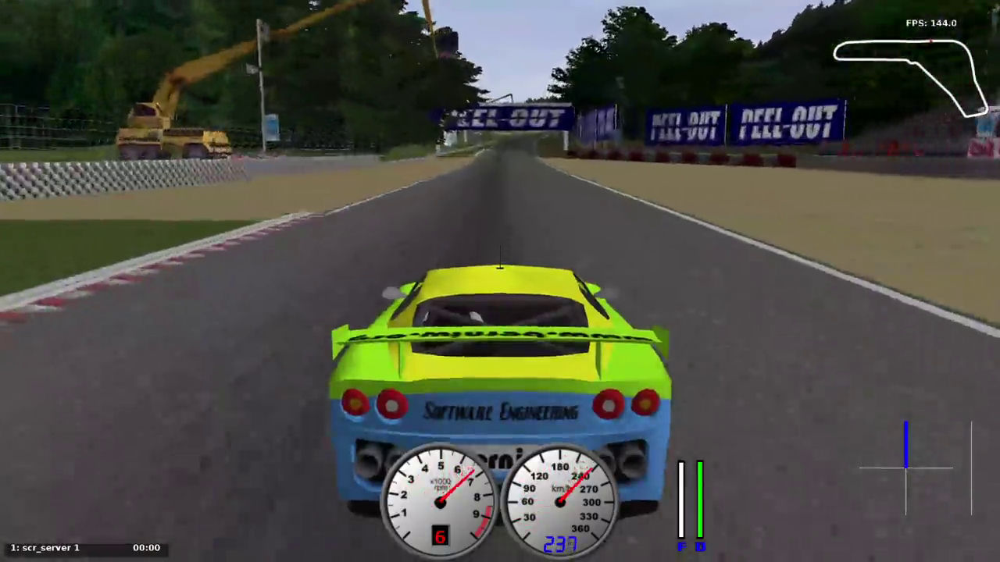

# 🏎️ Gran Premio MIVIA 2025 – Autonomous TORCS Agent

Progetto finale del corso **Intelligenza Artificiale: Metodi ed Applicazioni**  
Anno accademico 2024/2025 – *Università degli Studi di Salerno*.

---

## 🚀 Descrizione

Sistema di guida autonoma sviluppato in **Java** per il simulatore **TORCS**.  
L’agente intelligente apprende tramite **behavioral cloning**, imitando un pilota umano attraverso l’osservazione delle sue azioni.

Il progetto è stato sviluppato nell’ambito del contest "Gran Premio MIVIA 2025", dove ogni veicolo compete per ottenere il tempo sul giro migliore.

---

## 📚 Documentazione

- 
- 

## 🧠 Architettura

- **HumanDriver**: modalità di raccolta dati. Registra le coppie osservazione-azione durante la guida manuale.
- **AutonomousDriver**: modalità autonoma mediante regole. Utilizza un classificatore addestrato per prendere decisioni in tempo reale.
- **Classificatori**: implementazioni custom di k-NN e KDTree.
- **Moduli di supporto**: normalizzazione delle feature, visualizzazione radar,  utility per logging e istogrammi.

---

## ⚙️ Utilizzo

### Compilazione

```bash
./build.sh
```

### Esecuzione client guida manuale

```bash
./humanRun.sh
```

### Esecuzione client autonoma mediante regole

```bash
./simpleRun.sh
```

### Esecuzione client autonoma mediante KNN

```bash
./autonomousRun.sh
```

## 📊 Valutazione

Il sistema è stato testato secondo i seguenti criteri:

- Tempo minimo per completare un giro
- Stabilità dell’agente su più tentativi
- Robustezza a situazioni nuove o leggermente diverse dal training

## 🎥 Video

Il progetto include un Video Demo del funzionamento dell’agente in pista. [](docs/demo.mp4)

## 👥 Team - Gruppo 03

- Emanuele Tocci - <https://github.com/emanueletocci/>
- Alessio Leo - <https://github.com/Al3Leo>
- Claudia Montefusco - <https://github.com/ClaudiaMontefusco3>
- Rossella Pale - <https://github.com/rossellapale>
