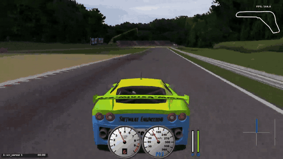

# 🏎️ Gran Premio MIVIA 2025 – Autonomous TORCS Agent

Progetto finale del corso **Intelligenza Artificiale: Metodi ed Applicazioni**  
Anno accademico 2024/2025 – *Università degli Studi di Salerno*.

<p align="center">
  
</p>

---

## 🚀 Descrizione

Sistema di guida autonoma sviluppato in **Java** per il simulatore **TORCS**.  
L’agente intelligente apprende tramite **behavioral cloning**, imitando un pilota umano attraverso l’osservazione delle sue azioni.

Il progetto è stato sviluppato nell’ambito del contest "Gran Premio MIVIA 2025", dove ogni veicolo compete per ottenere il tempo sul giro migliore.

---

## 🎥 Demo

<!--
  Per mostrare il player video qui sotto:
  1. modifica questo README direttamente su github.com;
  2. trascina il file docs/demo_web.mp4 in questo punto dell'editor;
  3. GitHub genera un link del tipo https://github.com/user-attachments/assets/...
     che, lasciato da solo su una riga, viene mostrato come video riproducibile.
  Poi cancella la riga segnaposto qui sotto.
-->
SOSTITUISCI_CON_IL_LINK_DEL_VIDEO

Video completo dell'agente autonomo in pista.

---

## 📚 Documentazione

- [Documentazione progettuale (PDF)](docs/Documentazione_Progettuale.pdf)
- [Presentazione (PDF)](docs/Presentazione_Progetto.pdf)
- [Javadoc](https://emanueletocci.github.io/unisa-ai-project/)

---

## 🧠 Architettura

- **HumanDriver**: modalità di raccolta dati. Registra le coppie osservazione-azione durante la guida manuale.
- **SimpleDriver**: modalità autonoma mediante regole, senza classificatore.
- **AutonomousDriver**: modalità autonoma mediante k-NN. Utilizza due classificatori addestrati per prendere decisioni in tempo reale: uno per la guida normale e uno per il recupero da situazioni critiche (fuori pista o veicolo bloccato).
- **Classificatori**: implementazioni custom di k-NN e KD-Tree.
- **Moduli di supporto**: estrazione e normalizzazione delle feature, visualizzazione radar, utility per logging e istogrammi.

---

## ⚙️ Utilizzo

### Prerequisiti

- **JDK 21** o superiore
- **TORCS** con la patch del server **SCR**, in ascolto sulla porta `3001`

Gli script vanno lanciati dalla root della repository, perché i dataset vengono letti dalla cartella `data/`.

### Compilazione

```bash
./src/build.sh
```

### Esecuzione client guida manuale

```bash
./src/humanRun.sh
```

### Esecuzione client autonoma mediante regole

```bash
./src/simpleRun.sh
```

### Esecuzione client autonoma mediante KNN

```bash
./src/autonomousRun.sh
```

---

## 📊 Valutazione

Il sistema è stato testato secondo i seguenti criteri:

- Tempo minimo per completare un giro
- Stabilità dell’agente su più tentativi
- Robustezza a situazioni nuove o leggermente diverse dal training

Sulla pista **Forza**, in una simulazione di 10 giri senza intervento umano, l’agente ha ottenuto un **giro migliore di 1:49.20** con una **velocità massima di 259 km/h**, usando **k = 1** per entrambi i classificatori.

---

## 👥 Team - Gruppo 03

- Emanuele Tocci - <https://github.com/emanueletocci/>
- Alessio Leo - <https://github.com/Al3Leo>
- Claudia Montefusco - <https://github.com/ClaudiaMontefusco3>
- Rossella Pale - <https://github.com/rossellapale>
